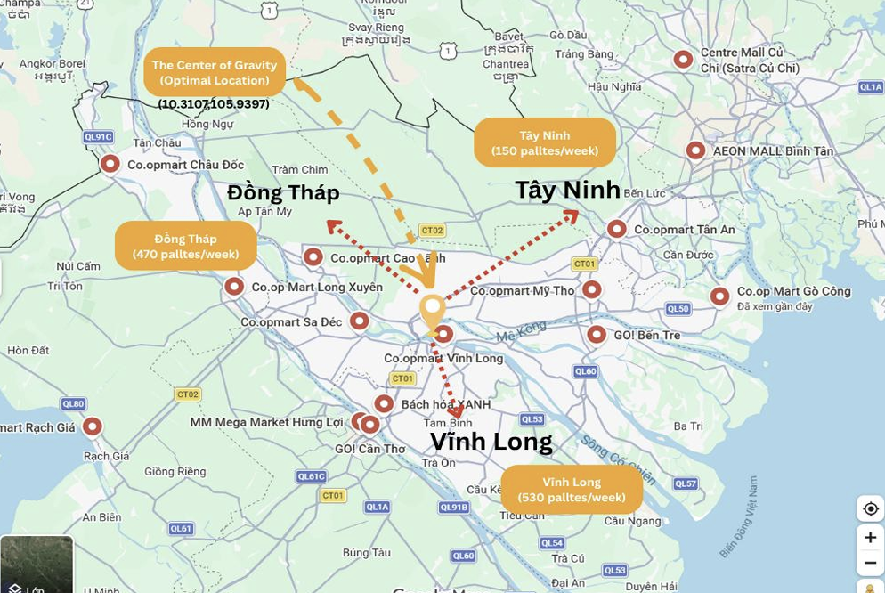
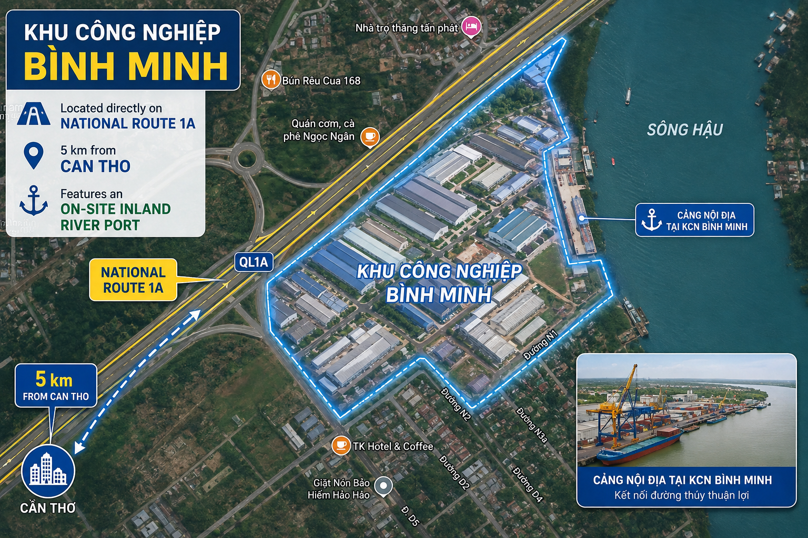

# SCLM-429
TRANSPORTATION AND LOGISTICS MANAGEMENT
# 1. Course Overview

This repository presents the key knowledge and practical applications gained from SCLM 429 - Transportation and Logistics Management. It includes selected course concepts and a group project focusing on transportation planning, facility location, and logistics strategy. 

---

# 2. Key Concepts & Learning Notes

- **Transportation Management:** Understanding transportation modes, costs, delivery time, and service performance.
- **Facility Location & Network Design:** Learning how to determine suitable facility locations and design efficient distribution networks.
- **Warehousing & Material Handling:** Understanding warehouse operations, packaging, palletization, and product handling.
- **Distribution & Fulfillment:** Exploring distribution strategies and the movement of goods from businesses to customers.
- **Logistics Performance:** Evaluating logistics decisions based on cost, efficiency, and operational effectiveness.

---

# 3. Group Project: 4ward – Mega Hub Location & Logistics Strategy for Mekong KVD

## 3.1. Project Overview

The project aims to consolidate Mekong KVD's four existing facilities into one integrated Mega Hub to improve logistics efficiency, reduce transportation costs, and minimize product damage.

**Key Project Information:**

| Category | Information |
| :--- | :--- |
| Project | Mega Hub Location & Logistics Strategy |
| Company | Mekong KVD |
| Weekly Demand | 2,060 pallets |
| Number of B2B Customers | 15 |
| Proposed Mega Hub Location | Bình Minh Industrial Park |
| Selected Location Score | 4.40/5 |

## 3.2. Center of Gravity (COG) Analysis

The Center of Gravity (COG) method was applied to identify the optimal geographical location based on the demand and locations of 15 B2B customers, representing a total volume of 2,060 pallets per week.

- **COG Coordinates:** 10.3107°N, 105.9397°E
- **Selected Location:** Bình Minh Industrial Park, Vĩnh Long

## 3.3. Industrial Park Selection

Three potential industrial parks were evaluated using a weighted scoring approach to identify the most suitable Mega Hub location.

| Criteria | Weight | Hoa Phu IP | Binh Minh IP | Long Hau IP |
| :--- | :--- | :--- | :--- | :--- |
| **Capital Expenditure (CapEx)** | 35% | 3 (1.05) | 4 (1.40) | 5 (1.75) |
| **Logistics & Market Accessibility** | 30% | 4 (1.20) | 5 (1.50) | 3 (0.90) |
| **Infrastructure & Utilities** | 20% | 5 (1.00) | 4 (0.80) | 5 (1.00) |
| **Remaining Lease Period** | 10% | 5 (0.50) | 5 (0.50) | 5 (0.50) |
| **Strategic Growth Potential** | 5% | 5 (0.25) | 4 (0.20) | 4 (0.20) |
| **Total Weighted Score** | 100% | 4.00 | **4.40** | 4.35 |
| **Rank** | | 3 | **1** | 2 |

**Final Decision:** Bình Minh Industrial Park was selected with the highest weighted score of **4.40/5**.

## 3.4. Transportation & Material Handling Strategy

The project proposed direct road freight to support product distribution to B2B customers. In addition, a multi-layer protective packaging system was recommended to reduce the risk of glass bottle breakage during loading, handling, and transportation.

## 3.5. D2C & Omnichannel Strategy

The final presentation further explored an omnichannel fulfillment model to expand Mekong KVD beyond its traditional B2B operations.

- **Micro-Fulfillment Centers (MFCs):** Using existing supermarket partners as local fulfillment points.
- **Distributed Order Management (DOM):** Coordinating orders and fulfillment across different locations.
- **Minimum Order Value (MOV):** Setting a threshold of 600,000 VND for D2C orders.

## 3.6. Project Outcomes

The project integrates facility location analysis, transportation planning, material handling, and omnichannel fulfillment into a proposed logistics solution. These recommendations aim to improve operational efficiency, reduce transportation costs, minimize product damage, and support Mekong KVD's future expansion.

---

*This repository is created for academic and learning purposes as part of SCLM 429 – Transportation and Logistics Management.*
